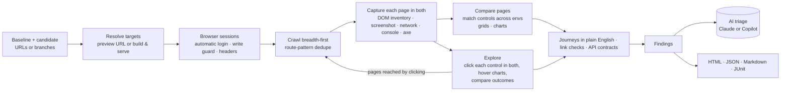

# envdiff

**Deep-compare two environments or branches of a web app — and find what the new code broke.**

Give envdiff two URLs (DEV vs UAT, UAT vs PROD, a PR preview vs production) or two
branch names. It logs in, crawls both, **clicks every safe control on every page in
both environments** — data grids and charts included — runs the journeys you write
in plain English, and compares what happened, visually and functionally. QA gets a
report of what's broken, what changed, and what's just different data.

```bash
envdiff https://www.example.com https://uat.example.com
envdiff prod uat --user admin --journey 'Go to Orders; Type "west" into Search; Sort by Amount'
```


## What it catches

| | Check | Example finding |
|---|---|---|
| 🖱️ | **Every interaction** — buttons, tabs, menus, dropdowns, toggles, filters followed by their Apply, and (with `--click-depth 2`) what they open | *Choosing "Price" in "Sort by" does nothing on candidate (baseline re-ordered the list)* |
| 🧮 | **Data grids** (AG Grid and ARIA grids) — columns, their order and value formats, `NaN`/empty columns, no rows, grids stuck loading; sorting and paging clicked | *Column "Region" is missing from the "Orders" grid*; *"Amount" shows plain numbers instead of amounts (4982.71 vs $6,237.68)* |
| 📈 | **Charts** (Highcharts) — series, legend, axes, "no data"; points hovered and their tooltips compared | *The "Monthly revenue" chart lost its "Target" series*; *its tooltip reads "Revenue: 11657" (baseline: "Revenue: $9,140")* |
| 🧭 | **Journeys in plain English** — flows you describe, run step by step in both | *"Type 'west' into Search orders" filters the grid on baseline and does nothing on candidate* |
| 💥 | **Uncaught exceptions & console errors**, per page and per click | *Clicking "Load more" throws TypeError: Cannot read properties of undefined* |
| 🌐 | **Failed requests** — pages, scripts, API calls, images | *GET /api/stats returns 500 on candidate after clicking "Refresh" (baseline: 200)* |
| 🧾 | **API contracts** — JSON response *shapes*, not values, so different data is fine | *GET /api/profile: candidate response lacks `email`; `age` number → string* |
| 📦 | **Request payloads** of blocked writes | *Clicking "Add to cart" sends POST /api/cart without `qty`* |
| 🚪 | **Availability & navigation** — 404/500s, redirects, links to pages that don't exist | *Candidate links ("Contact") to /contact-us, which returns 404* |
| 🧩 | **Missing / disabled / relabelled controls** — telling data-driven lists apart from real removals | *Missing on candidate: button "Add to wishlist"* |
| 📝 | **Forms** — fields and validation | *Field "Email" is no longer required* |
| 🔤 | **Content** — text diffs (timestamps normalized), and broken renders: `undefined`, `NaN`, `[object Object]`, `{{template}}`, raw i18n keys, error banners, mojibake | *Candidate shows NaN: "Price: $NaN"* |
| 🎨 | **Visual** — pixel diffs with changed regions named, layout shifts, style changes, horizontal overflow on mobile | *Content shifted down 52px from "Subscribe"*; *Page scrolls sideways on mobile* |
| ♿ | **Accessibility** — new axe-core violations | *Images must have alternative text — 1 element, new* |
| ⏱️ | **Performance** — TTFB, FCP, LCP, load, CLS, page weight (as leads, not verdicts) | *Slower on candidate: LCP 136ms → 1.4s* |
| 🔒 | **SEO & security headers** — `noindex` appearing, canonical/lang changes, dropped HSTS/CSP/X-Frame-Options | *Response header x-frame-options is missing on candidate* |

Every finding has a severity (**critical / major / minor / info**), the evidence
(baseline vs candidate screenshots and a diff), and a stable id you can use to
accept known differences.

## Quick start

Needs Node.js 20+.

```bash
git clone https://github.com/suchith-arella/envdiff && cd envdiff
npm ci
npx playwright install --with-deps chromium      # once; or use --channel chrome
npm link                                         # puts `envdiff` on your PATH

envdiff https://www.example.com https://uat.example.com
open envdiff-report/index.html
```

See it on a demo shop with planted regressions (takes about a minute):

```bash
npm run demo && open envdiff-demo/index.html
```

Useful flags:

```bash
envdiff <baseline> <candidate> \
  --viewports desktop,mobile     # compare responsive layouts too
  --paths /,/checkout,/account   # start pages
  --max-pages 50 --depth 3       # crawl budget
  --click-depth 2                # also click inside menus/dialogs that clicks open
  --mask .timestamp --mask .ads  # paint over dynamic regions before screenshots
  --fail-on major                # exit code 1 at major or worse (CI gating)
```

`envdiff --help` lists everything; [docs/configuration.md](docs/configuration.md)
covers the config file (`envdiff init` writes a commented starter).

## Comparing branches

Branch names work in place of URLs. envdiff needs to know how to reach a branch:

**Preview deployments** (Vercel, Netlify, Cloudflare Pages, Amplify…): give the URL pattern.

```bash
envdiff main feature/checkout --url-template "https://{branch}--myshop.netlify.app"
```

**No deployments**: envdiff checks each branch out into a git worktree, installs,
builds, starts it on its own port, compares, then cleans up.

```yaml
# envdiff.branches.yaml
branches:
  serve:
    install: npm ci
    build: npm run build
    start: npm start -- --port $PORT
```

```bash
envdiff main feature/checkout -c envdiff.branches.yaml
```

## In GitHub Actions

envdiff is a GitHub Action. In your app's repository:

```yaml
- uses: suchith-arella/envdiff@main
  with:
    baseline: https://www.example.com
    candidate: https://uat.example.com
    viewports: desktop,mobile
    fail-on: major
```

With your environments and logins in repository variables and secrets (see
[Logged-in apps](#logged-in-apps)), name them instead, and add journeys and AI:

```yaml
permissions:
  contents: read
  copilot-requests: write          # only for ai: copilot
# …
- uses: suchith-arella/envdiff@main
  env:
    ENVDIFF_PROD_URL: ${{ vars.ENVDIFF_PROD_URL }}
    ENVDIFF_UAT_URL: ${{ vars.ENVDIFF_UAT_URL }}
    ENVDIFF_BASELINE_USERNAME: ${{ secrets.ENVDIFF_PROD_ADMIN_USERNAME }}
    ENVDIFF_BASELINE_PASSWORD: ${{ secrets.ENVDIFF_PROD_ADMIN_PASSWORD }}
    ENVDIFF_CANDIDATE_USERNAME: ${{ secrets.ENVDIFF_UAT_ADMIN_USERNAME }}
    ENVDIFF_CANDIDATE_PASSWORD: ${{ secrets.ENVDIFF_UAT_ADMIN_PASSWORD }}
  with:
    baseline: prod
    candidate: uat
    user: admin
    journey: |
      Journey: Monthly sales
      Open Reports
      Select "Last 30 days" from Date range
      Click Apply
      Expect to see "Sales by region"
    journey-file: qa/journeys.md
    ai: copilot
```

It installs itself and Chromium, runs the comparison, writes the summary to the job
page, uploads the full report as an artifact, and fails the step when there are
findings at or above `fail-on`. Outputs: `verdict`, `critical`, `major`, `minor`,
`info`, `report-dir`, `exit-code`.

Ready-to-copy workflows in [examples/workflows](examples/workflows):

| Workflow | When |
|---|---|
| [qa-on-demand.yml](examples/workflows/qa-on-demand.yml) | QA pastes two URLs in the Actions tab and gets a report |
| [pr-preview.yml](examples/workflows/pr-preview.yml) | Every PR: preview deployment vs production, result posted as one updated PR comment |
| [branches-local.yml](examples/workflows/branches-local.yml) | Every PR: base branch vs PR branch, both built and served inside the job |
| [nightly.yml](examples/workflows/nightly.yml) | Every weekday morning: is UAT still behaving like production? |

This repository also has a ready-made **Compare environments** workflow
([compare.yml](.github/workflows/compare.yml); Actions tab → Run workflow): pick the
baseline and candidate from dev / uat / prod, list the users to log in as (one run
per user, in parallel, each with its own report), type a journey, and choose the AI.
It reads `ENVDIFF_<ENV>_URL` from repository variables and each user's login from
secrets named `ENVDIFF_<ENV>_<USER>_USERNAME` / `_PASSWORD` (`ENVDIFF_<ENV>_USERNAME`
for the default user). Inputs reach the shell through environment variables, never
through `${{ }}` interpolation, so branch names and URLs can't inject commands.

## Reading the report

`index.html` is a single offline page (screenshots live next to it in `assets/`):

- **Findings**: everything, worst first, filterable by severity, category and text.
  Click a row for details, evidence and the finding id.
- **Pages**: per page, both statuses, the visual comparison (side-by-side, swipe,
  onion skin, pixel diff, with changed regions outlined and named), every
  interaction with what it did on each side, the text diff, and axe results.
- **Interactions**: every click across the run; by default only the ones that
  behaved differently, each with after-click screenshots of both sides.
- **Journeys**, **API** (every JSON endpoint seen, with statuses per side), and
  **Run info** (settings, errors, links that were found but not crawled).


Alongside it: `report.json` (everything, for scripts and agents), `summary.md` (the
GitHub summary / PR comment) and `junit.xml` (one test case per page and journey,
for test dashboards).

**Exit codes**: `0` nothing at or above `--fail-on` · `1` regressions found ·
`2` envdiff couldn't run (unreachable environment, bad config, failed login) ·
`130` interrupted. Ctrl+C once finishes the pages in progress and still writes a
(partial) report; twice quits.

## Safe to point at production

Clicking everything in production must not place orders or delete accounts:

- **Writes are blocked.** POST/PUT/PATCH/DELETE requests are aborted in the browser
  before they leave it. The request is still recorded — method, endpoint, and the
  *shape* of its body — so "this button now sends a different payload" is still
  caught. GraphQL queries pass; GraphQL mutations don't. Use `--allow-mutations` only
  for environments with disposable data.
- **Destructive-looking controls are never clicked**: delete, remove account, pay,
  buy now, place order, unsubscribe, log out, and similar (`safety.useDefaultDenyList`,
  `explore.skip`, `explore.allow`). Logout URLs are never visited.
- **No popups, downloads or dialogs escape**: new tabs are closed after their URL is
  recorded, downloads cancelled, `confirm()` answered "Cancel".
- **Credentials stay scoped**: custom headers are added only to requests for that
  environment's own origin — never to analytics or CDNs — and basic-auth
  credentials only answer that origin's challenge. Secrets can come from
  environment variables (`ENVDIFF_BASELINE_HEADERS`, `ENVDIFF_CANDIDATE_AUTH`…) so
  they never appear in command lines or logs.

## Logged-in apps

Name your environments and give each its users through environment variables (in
CI: repository variables and secrets), and envdiff logs in by itself:

```bash
export ENVDIFF_PROD_URL=https://app.example.com  ENVDIFF_UAT_URL=https://uat.example.com
export ENVDIFF_PROD_USERNAME=qa@example.com      ENVDIFF_PROD_PASSWORD=…
export ENVDIFF_UAT_USERNAME=qa@example.com       ENVDIFF_UAT_PASSWORD=…
export ENVDIFF_UAT_ADMIN_USERNAME=admin@example.com ENVDIFF_UAT_ADMIN_PASSWORD=…   # another user
envdiff prod uat                  # as the default user
envdiff prod uat --user admin     # as admin: ENVDIFF_<ENV>_ADMIN_USERNAME / _PASSWORD
```

| Variable | |
|---|---|
| `ENVDIFF_<ENV>_URL` | where the environment lives; makes `<env>` usable in place of a URL |
| `ENVDIFF_<ENV>_USERNAME`, `_PASSWORD` | its default user |
| `ENVDIFF_<ENV>_<USER>_USERNAME`, `_PASSWORD` | another user, picked with `--user <user>` |
| `ENVDIFF_<ENV>[_<USER>]_TOTP` | authenticator secret, when the login asks for a one-time code |
| `ENVDIFF_BASELINE_*`, `ENVDIFF_CANDIDATE_*` | per side, overriding the above |

The login form is found the way a person finds it: from the start page, following
its "Log in" link if there is one (an email field in a contact or newsletter form on
a landing page is not taken for it); username first and password on the next screen
works too, and so does a one-time code from the authenticator secret. A wrong
password, a CAPTCHA or a form that never goes away stops the run with a clear
message (and a screenshot) rather than comparing two login pages. Once in, envdiff:

- starts the crawl where the app lands after logging in, and never visits the login
  page or clicks "Log in" / "Log out" again;
- carries the session to every tab, including tokens apps keep in `sessionStorage`;
- logs back in when a session ends mid-run (a page shows the login form where the
  other environment shows the page);
- shows who was logged in on the report, with the username masked. Passwords never
  reach the report or the logs.

Names can also live in a config file, with the logins in variables:

```yaml
environments:
  prod: { url: https://app.example.com }
  uat:  { url: https://uat.example.com, users: { admin: { username: "${UAT_ADMIN}", password: "${UAT_ADMIN_PW}" } } }
auth:
  loginUrl: /#/login            # optional: where the form is
  # steps: […]                  # optional: script it, for forms the automatic login can't handle
```

A scripted login uses the same steps as journeys, with `{{username}}`, `{{password}}`
and `{{totp}}` filled in per environment. For SSO, log in by hand once and reuse the
session:

```bash
envdiff login https://uat.example.com --save uat.json     # opens a browser
envdiff https://www.example.com https://uat.example.com --candidate-storage uat.json
```

Also supported: HTTP basic auth (`--candidate-auth user:pass`), preview-protection
bypass headers (`--candidate-header "x-vercel-protection-bypass: …"`), and cookies.
Bot-protection sensors may post while envdiff browses (`safety.allowBotSensors`):
they write no app data, and blocking them can get the session flagged.

## Grids and charts

Data-heavy apps are mostly grids and charts, and their contents are data: UAT and
production hold different orders, different revenue. So envdiff compares them for
what makes them work:

- **Grids** (AG Grid, and any grid following the ARIA grid pattern): which columns
  there are and in what order; how each column's values look — amounts, percentages,
  dates, decimals, thousands separators — so `$6,237.68` turning into `6237.68` is
  caught while different amounts aren't; cells showing `NaN`, `undefined` or
  `[object Object]`; a column that went empty; a grid with no rows, or still
  "Loading…" after everything else is done; a lost default sort or paging. Column
  headers and paging buttons are clicked like any control — a column that no longer
  sorts is caught — and two rows per grid are clicked, not all of them.
- **Charts** (Highcharts): series, their types and visibility, the legend, axis
  titles, a "No data" message. Legend items are clicked (show/hide a series), and a
  few points of each chart are hovered: a tooltip that no longer appears, or reads
  differently once numbers are taken out (`Revenue: $12,400` vs `Revenue: 12400`), is
  reported.
- **Waiting**: pages are compared once loading overlays and spinners are gone, not
  just when the network goes quiet (`stabilize.busySelectors`).

By default (`data: different`) numbers in text are compared for format, not value,
and grids and charts are left out of pixel comparisons (they show hatched in the diff
image). When both sides hold the same data — two builds against one backend — use
`--same-data` to compare cell values, chart points and every number too.

## Taming differences that aren't bugs

Two environments always differ somewhere. envdiff handles the common cases itself:
timestamps and relative times are normalized out of text, links into a list
("Blue shirt" vs "Red hat") are recognized as data, fewer repetitions of the same
control ("Add to cart" ×12 vs ×9) aren't "missing", API comparisons use JSON shapes
rather than values, changes to the site header/footer are reported once rather than
on every page, cookie banners are dismissed, and the environment's name in the page
title is ignored.

For the rest:

```yaml
visual:
  mask: [".clock", "[data-testid=ad]"]     # painted over in screenshots and ignored in text
  freezeTime: "2025-01-01T10:00:00Z"       # same Date.now() in both
ignore:
  text: ["Build \\w+"]
  selectors: [".recommendations"]          # ignored for controls, text and accessibility
  findings: ["1aa2a4092b", "perf.*"]       # accept a known finding by id, or a whole type
severity: { "seo.*": info }                # re-grade a type
```

Every finding shows its id in the report: add it to `ignore.findings` to accept that
difference in future runs.

## Journeys

Crawling and clicking covers breadth. For depth — the flows that matter — describe
them in plain English and envdiff runs them on both environments, step by step:

```text
Journey: Filter orders
1. Go to Orders
2. Type "west" into Search orders
3. Sort by Amount descending
4. Make sure the Orders grid has rows
5. Take a screenshot "West orders"

Journey: Monthly sales
- Open Reports
- Select "Last 30 days" from Date range
- Click Apply
- Expect to see "Sales by region"
- Hover over the Sales by region chart
```

```bash
envdiff prod uat --journey-file qa/journeys.md
envdiff prod uat --no-crawl --journey 'Go to Orders; Type "west" into Search orders; Sort by Amount'
```

Steps can **go to** a page (by name, or a path), **click** / **press** / **open**,
**type** "…" **into** a field, **select** "…" **from** a dropdown (native or custom),
**check** / **uncheck**, **hover over** an element or a chart, **sort by** a column,
go to the **next page**, click the **first row** of a grid, **press Enter**, **wait**,
and **expect** / **verify** / **make sure**: text is shown or gone, the URL contains
something, a grid has rows, a chart has a series, there are no errors. Controls are
found by what they're called on screen — label, placeholder, button text, column
header — so steps read the way a tester writes them. `{{username}}` and
`{{password}}` type the logged-in user's credentials, `{{env.NAME}}` an environment
variable; these never appear in the report.

The baseline goes first; the candidate then does the same thing to the same control.
A step that works on the baseline and fails on the candidate is a critical finding; a
step that changes the page on the baseline but does nothing on the candidate (a
search box that filters nothing, a column that doesn't sort) is a major one; tooltips
read while hovering are compared; new errors and failed requests along the way are
reported. With AI enabled (`--ai`), a step envdiff can't read, or whose target it
can't find, is worked out by the AI against the page as it stands.

Journeys can also be scripted precisely in the config, mixing plain-English steps
with exact ones:

```yaml
journeys:
  - name: Checkout
    steps:
      - goto: /products/1
      - Click Add to cart
      - click: { role: link, name: Cart }
      - expectText: { selector: h1, text: Your cart }
      - screenshot: Cart                  # visual checkpoint
```

Locators: `{ role, name }`, `{ label }`, `{ text }`, `{ testId }`, `{ placeholder }`
or any Playwright selector. Journeys may set `allowMutations: true` for disposable
environments.

## AI (optional)

With `--ai`, an AI model reviews the findings with the screenshots as evidence and
labels each one **regression**, **intended change**, **environment difference** or
**noise**, with a one-line reason, writes a short summary for the top of the report,
and works out journey steps envdiff can't read on its own. Two providers:

| `--ai-provider` | Uses | Needs |
|---|---|---|
| `copilot` | **GitHub Copilot**, as the signed-in GitHub user | In GitHub Actions: `permissions: copilot-requests: write` and the action's `ai: copilot` — the workflow's own token is enough (organizations: allow "Copilot CLI billed to the organization" in the Copilot policies). Locally: `copilot login` or `GH_TOKEN`, and `npm install @github/copilot-sdk` |
| `anthropic` | **Claude** (`claude-opus-5-5`) through the Anthropic API | `ANTHROPIC_API_KEY` |

`--ai` alone picks Anthropic when its key is set, otherwise Copilot; `--ai-model`
picks a model (Copilot's default is its automatic choice). Copilot runs with no tools
at all and every permission request refused: it only reads what envdiff sends it.
Claude runs with server-side model fallback, so a declined request is retried rather
than lost.

- Labels are advice: they never change severities or the pass/fail verdict.
- Screenshots and finding details go to the provider — don't enable it for
  environments whose content may not leave your network.
- Cost scales with the number of pages that have findings (`ai.maxItems`, default
  25): each is one request with a few screenshot crops.

## With Claude Code

This repository includes a [Claude Code skill](.claude/skills/envdiff/SKILL.md); copy
`.claude/skills/envdiff/` into your app's repository to use it there. Then ask something like
*"compare UAT with production and tell me what's broken on checkout"*: Claude runs
envdiff, reads `report.json`, looks at the screenshots of the worst findings, and
writes up the regressions — re-running narrower comparisons where it needs to.

## How it works



- **Matching controls across environments** is what makes clicking comparable: each
  control is identified by its role, accessible name and landmark (and test id, id,
  href or field name when present), with fuzzy name matching for renamed controls.
- **Each click starts from the same state in both environments.** Clicks that change
  nothing don't cost a reload; clicks that do are undone by reloading (and replaying
  the steps that led there, for nested exploration).
- **"Did it do anything?"** is judged from navigation, network calls, new dialogs,
  DOM/text changes, the control's own state, popups, downloads and alerts. Pages
  that change on their own (tickers, carousels) are detected, so movement alone
  isn't taken as a response. A control is scrolled into view, and the page given
  time to react, before it's clicked, so sticky headers and scrollspy changes
  caused by scrolling aren't credited to the click. When a click opens a dialog
  in both environments, the dialogs themselves are compared, not the page
  behind them.
- **Look twice before reporting.** Environments differ in speed, and apps that
  finish booting late or animate on scroll make one-off differences. A page or
  interaction that differs is repeated in both environments, and only the
  differences that happen both times are reported. The rest are listed as
  "didn't reproduce" (`stabilize.confirm`).
- **Noise that isn't the app** is left out: analytics and ad hosts, and
  bot-protection beacons that post to a machine-generated path that is different
  on every environment.

## Limitations

- Text inputs aren't fuzzed: forms are compared structurally, and filled in by
  journeys. Canvas/WebGL content (including canvas-drawn charts) is compared only
  as pixels; grids are read from the DOM, so rows outside the visible window of a
  virtualized grid aren't inspected cell by cell.
- The write guard sees HTTP requests. Apps that write over WebSockets rely on the
  destructive-control deny list alone — or a disposable environment.
- Clicking is breadth-first within a budget (`explore.maxActionsPerPage`): controls
  beyond it are listed under "Not clicked". Site-wide controls are clicked once per run.
- Environments with different data: numbers, grid cells and chart values are
  compared for format, not value (`data: different`), but other data — names in a
  list, a different number of cards — can still show as text and visual
  differences. Masks, ignores and the AI triage are the tools for that.
- Journeys run as the user the comparison logs in as; switching users within a
  journey isn't supported (run again with `--user`).
- Full-page screenshots show a page as it stands at the top. A section that a
  page hides again once it scrolls out of view can be caught hidden on one side;
  its controls are still compared (they're noted while scrolling through), and
  such a difference is usually small and listed as minor.

## Development

```bash
npm test            # unit tests
npm run test:e2e    # the fixtures: all planted regressions found, identical sites clean
npm run typecheck   # JSDoc types checked with tsc
npm run demo        # build a report from the fixture shop
```

Two fixtures, each with a baseline and a candidate variant; every deliberate
regression is marked `REGRESSION` in the source:

- a shop ([test/fixtures/site](test/fixtures/site/server.js)): crawling, clicking,
  visual, API and content checks;
- "Insights", an analytics app ([test/fixtures/app](test/fixtures/app/server.js)):
  hash routes, a login (with a one-time-code user), real AG Grid grids, charts with
  Highcharts' DOM, filters with an Apply button, sessions that expire — and
  different data on each side, as UAT and production have.
