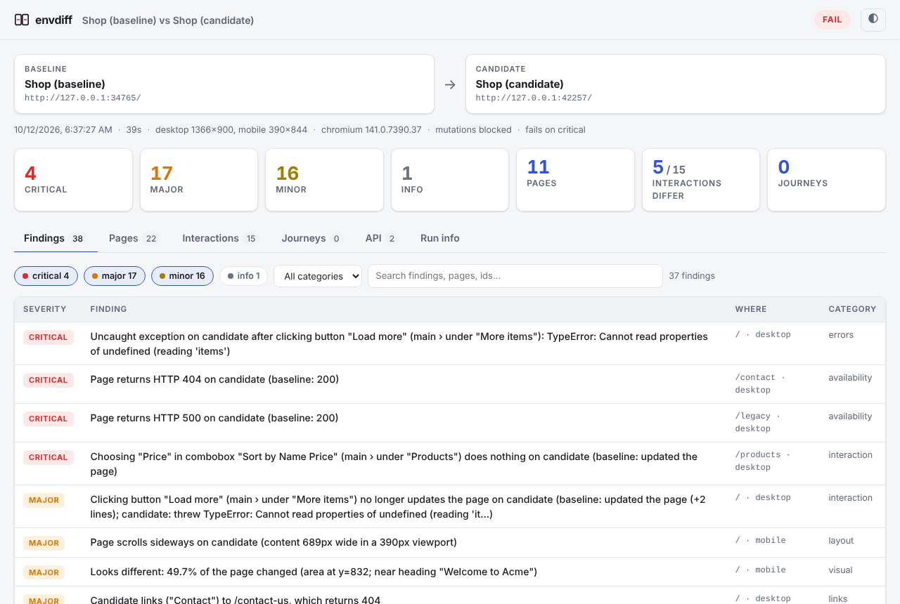
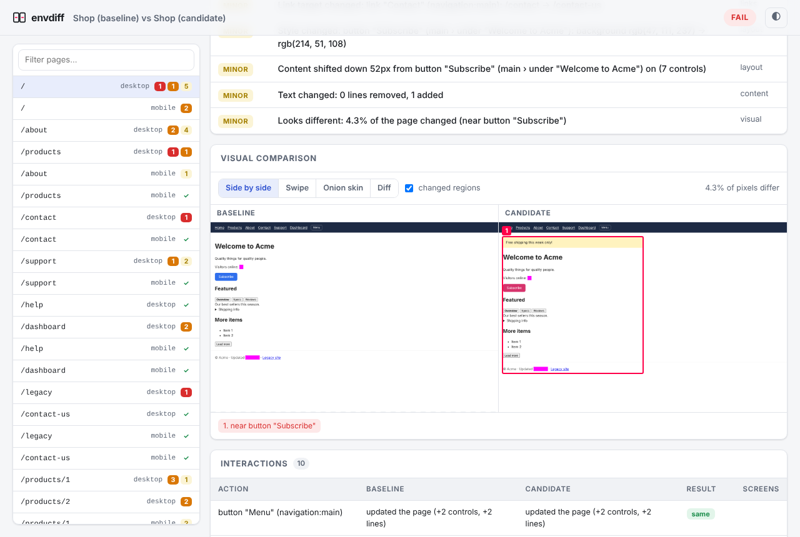
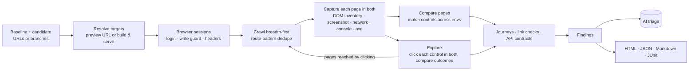

# envdiff

**Deep-compare two environments or branches of a web app — and find what the new code broke.**

Give envdiff two URLs (DEV vs UAT, UAT vs PROD, a PR preview vs production) or two
branch names. It crawls both, **clicks every safe control on every page in both
environments**, and compares what happened — visually and functionally — then hands
QA a report of what's broken, what changed, and what's just different data.

```bash
envdiff https://www.example.com https://uat.example.com
```



## What it catches

| | Check | Example finding |
|---|---|---|
| 🖱️ | **Every interaction** — buttons, tabs, menus, dropdowns, toggles, and (with `--click-depth 2`) what they open | *Choosing "Price" in "Sort by" does nothing on candidate (baseline re-ordered the list)* |
| 💥 | **Uncaught exceptions & console errors**, per page and per click | *Clicking "Load more" throws TypeError: Cannot read properties of undefined* |
| 🌐 | **Failed requests** — pages, scripts, API calls, images | *GET /api/stats returns 500 on candidate after clicking "Refresh" (baseline: 200)* |
| 🧾 | **API contracts** — JSON response *shapes*, not values, so different data is fine | *GET /api/profile: candidate response lacks `email`; `age` number → string* |
| 📦 | **Request payloads** of blocked writes | *Clicking "Add to cart" sends POST /api/cart without `qty`* |
| 🚪 | **Availability & navigation** — 404/500s, redirects, links to pages that don't exist | *Candidate links ("Contact") to /contact-us, which returns 404* |
| 🧩 | **Missing / disabled / relabelled controls** — telling data-driven lists apart from real removals | *Missing on candidate: button "Add to wishlist"* |
| 📝 | **Forms** — fields and validation | *Field "Email" is no longer required* |
| 🔤 | **Content** — text diffs (timestamps normalized), and broken renders: `undefined`, `NaN`, `[object Object]`, `{{template}}`, raw i18n keys, error banners, mojibake | *Candidate shows NaN: "Price: $NaN"* |
| 🎨 | **Visual** — pixel diffs with changed regions named, layout shifts, style changes, horizontal overflow on mobile | *Content shifted down 52px from "Subscribe"*; *Page scrolls sideways on mobile* |
| ♿ | **Accessibility** — new axe-core violations | *Images must have alternative text — 1 element, new* |
| ⏱️ | **Performance** — TTFB, FCP, LCP, load, CLS, page weight (as leads, not verdicts) | *Slower on candidate: LCP 136ms → 1.4s* |
| 🔒 | **SEO & security headers** — `noindex` appearing, canonical/lang changes, dropped HSTS/CSP/X-Frame-Options | *Response header x-frame-options is missing on candidate* |

Every finding has a severity (**critical / major / minor / info**), the evidence
(baseline vs candidate screenshots and a diff), and a stable id you can use to
accept known differences.

## Quick start

Needs Node.js 20+.

```bash
git clone https://github.com/suchith-arella/envdiff && cd envdiff
npm ci
npx playwright install --with-deps chromium      # once; or use --channel chrome
npm link                                         # puts `envdiff` on your PATH

envdiff https://www.example.com https://uat.example.com
open envdiff-report/index.html
```

See it on a demo shop with planted regressions (takes about a minute):

```bash
npm run demo && open envdiff-demo/index.html
```

Useful flags:

```bash
envdiff <baseline> <candidate> \
  --viewports desktop,mobile     # compare responsive layouts too
  --paths /,/checkout,/account   # start pages
  --max-pages 50 --depth 3       # crawl budget
  --click-depth 2                # also click inside menus/dialogs that clicks open
  --mask .timestamp --mask .ads  # paint over dynamic regions before screenshots
  --fail-on major                # exit code 1 at major or worse (CI gating)
```

`envdiff --help` lists everything; [docs/configuration.md](docs/configuration.md)
covers the config file (`envdiff init` writes a commented starter).

## Comparing branches

Branch names work in place of URLs. envdiff needs to know how to reach a branch:

**Preview deployments** (Vercel, Netlify, Cloudflare Pages, Amplify…): give the URL pattern.

```bash
envdiff main feature/checkout --url-template "https://{branch}--myshop.netlify.app"
```

**No deployments**: envdiff checks each branch out into a git worktree, installs,
builds, starts it on its own port, compares, then cleans up.

```yaml
# envdiff.branches.yaml
branches:
  serve:
    install: npm ci
    build: npm run build
    start: npm start -- --port $PORT
```

```bash
envdiff main feature/checkout -c envdiff.branches.yaml
```

## In GitHub Actions

envdiff is a GitHub Action. In your app's repository:

```yaml
- uses: suchith-arella/envdiff@main
  with:
    baseline: https://www.example.com
    candidate: https://uat.example.com
    viewports: desktop,mobile
    fail-on: major
```

It installs itself and Chromium, runs the comparison, writes the summary to the job
page, uploads the full report as an artifact, and fails the step when there are
findings at or above `fail-on`. Outputs: `verdict`, `critical`, `major`, `minor`,
`info`, `report-dir`, `exit-code`.

Ready-to-copy workflows in [examples/workflows](examples/workflows):

| Workflow | When |
|---|---|
| [qa-on-demand.yml](examples/workflows/qa-on-demand.yml) | QA pastes two URLs in the Actions tab and gets a report |
| [pr-preview.yml](examples/workflows/pr-preview.yml) | Every PR: preview deployment vs production, result posted as one updated PR comment |
| [branches-local.yml](examples/workflows/branches-local.yml) | Every PR: base branch vs PR branch, both built and served inside the job |
| [nightly.yml](examples/workflows/nightly.yml) | Every weekday morning: is UAT still behaving like production? |

This repository also has a ready-made **Compare environments** workflow
(Actions tab → Run workflow) if you'd rather not add anything to your app's repo.
Inputs reach the shell through environment variables, never through `${{ }}`
interpolation, so branch names and URLs can't inject commands.

## Reading the report

`index.html` is a single offline page (screenshots live next to it in `assets/`):

- **Findings**: everything, worst first, filterable by severity, category and text.
  Click a row for details, evidence and the finding id.
- **Pages**: per page, both statuses, the visual comparison (side-by-side, swipe,
  onion skin, pixel diff, with changed regions outlined and named), every
  interaction with what it did on each side, the text diff, and axe results.
- **Interactions**: every click across the run; by default only the ones that
  behaved differently, each with after-click screenshots of both sides.
- **Journeys**, **API** (every JSON endpoint seen, with statuses per side), and
  **Run info** (settings, errors, links that were found but not crawled).



Alongside it: `report.json` (everything, for scripts and agents), `summary.md` (the
GitHub summary / PR comment) and `junit.xml` (one test case per page and journey,
for test dashboards).

**Exit codes**: `0` nothing at or above `--fail-on` · `1` regressions found ·
`2` envdiff couldn't run (unreachable environment, bad config, failed login) ·
`130` interrupted. Ctrl+C once finishes the pages in progress and still writes a
(partial) report; twice quits.

## Safe to point at production

Clicking everything in production must not place orders or delete accounts:

- **Writes are blocked.** POST/PUT/PATCH/DELETE requests are aborted in the browser
  before they leave it. The request is still recorded — method, endpoint, and the
  *shape* of its body — so "this button now sends a different payload" is still
  caught. GraphQL queries pass; GraphQL mutations don't. Use `--allow-mutations` only
  for environments with disposable data.
- **Destructive-looking controls are never clicked**: delete, remove account, pay,
  buy now, place order, unsubscribe, log out, and similar (`safety.useDefaultDenyList`,
  `explore.skip`, `explore.allow`). Logout URLs are never visited.
- **No popups, downloads or dialogs escape**: new tabs are closed after their URL is
  recorded, downloads cancelled, `confirm()` answered "Cancel".
- **Credentials stay scoped**: custom headers are added only to requests for that
  environment's own origin — never to analytics or CDNs — and basic-auth
  credentials only answer that origin's challenge. Secrets can come from
  environment variables (`ENVDIFF_BASELINE_HEADERS`, `ENVDIFF_CANDIDATE_AUTH`…) so
  they never appear in command lines or logs.

## Logged-in apps

```yaml
auth:                       # runs once per environment, before the crawl
  loginUrl: /login
  steps:
    - fill: { label: Email, value: "${QA_USER}" }
    - fill: { label: Password, value: "${QA_PASSWORD}" }
    - click: { role: button, name: Sign in }
  successUrl: "**/dashboard**"
```

Different credentials per environment go under `baseline.auth` / `candidate.auth`.
For SSO or MFA, log in by hand once and reuse the session:

```bash
envdiff login https://uat.example.com --save uat.json     # opens a browser
envdiff https://www.example.com https://uat.example.com --candidate-storage uat.json
```

Also supported: HTTP basic auth (`--candidate-auth user:pass`), preview-protection
bypass headers (`--candidate-header "x-vercel-protection-bypass: …"`), and cookies.

## Taming differences that aren't bugs

Two environments always differ somewhere. envdiff handles the common cases itself:
timestamps and relative times are normalized out of text, links into a list
("Blue shirt" vs "Red hat") are recognized as data, fewer repetitions of the same
control ("Add to cart" ×12 vs ×9) aren't "missing", API comparisons use JSON shapes
rather than values, changes to the site header/footer are reported once rather than
on every page, cookie banners are dismissed, and the environment's name in the page
title is ignored.

For the rest:

```yaml
visual:
  mask: [".clock", "[data-testid=ad]"]     # painted over in screenshots and ignored in text
  freezeTime: "2025-01-01T10:00:00Z"       # same Date.now() in both
ignore:
  text: ["Build \\w+"]
  selectors: [".recommendations"]          # ignored for controls, text and accessibility
  findings: ["1aa2a4092b", "perf.*"]       # accept a known finding by id, or a whole type
severity: { "seo.*": info }                # re-grade a type
```

Every finding shows its id in the report: add it to `ignore.findings` to accept that
difference in future runs.

## Journeys

Crawling and clicking covers breadth. For depth — multi-step flows that matter —
script them once and envdiff runs them on both environments, step by step:

```yaml
journeys:
  - name: Checkout
    steps:
      - goto: /products/1
      - click: { role: button, name: Add to cart }
      - click: { role: link, name: Cart }
      - expectText: { selector: h1, text: Your cart }
      - screenshot: Cart                  # visual checkpoint
```

A step that works on the baseline and fails on the candidate is a critical finding;
steps that land on different pages, new errors and failed requests along the way are
reported too. Locators: `{ role, name }`, `{ label }`, `{ text }`, `{ testId }`,
`{ placeholder }` or any Playwright selector. Journeys may set `allowMutations: true`
for disposable environments.

## AI triage (optional)

With `--ai` (and `ANTHROPIC_API_KEY` set), Claude reviews the findings with the
screenshots as evidence and labels each one **regression**, **intended change**,
**environment difference** or **noise**, with a one-line reason, and writes a short
summary for the top of the report. It uses `claude-opus-5-5` (`--ai-model` to
change), with server-side model fallback enabled so a declined request is retried
rather than lost.

- Labels are advice: they never change severities or the pass/fail verdict.
- It sends screenshots and finding details to the Anthropic API — don't enable it
  for environments whose content may not leave your network.
- Cost scales with the number of pages that have findings (`ai.maxItems`, default 25):
  each is one request with a few screenshot crops, so a full run is on the order of
  a dollar or two with the default model.

## With Claude Code

This repository includes a [Claude Code skill](.claude/skills/envdiff/SKILL.md); copy
`.claude/skills/envdiff/` into your app's repository to use it there. Then ask something like
*"compare UAT with production and tell me what's broken on checkout"*: Claude runs
envdiff, reads `report.json`, looks at the screenshots of the worst findings, and
writes up the regressions — re-running narrower comparisons where it needs to.

## How it works



- **Matching controls across environments** is what makes clicking comparable: each
  control is identified by its role, accessible name and landmark (and test id, id,
  href or field name when present), with fuzzy name matching for renamed controls.
- **Each click starts from the same state in both environments.** Clicks that change
  nothing don't cost a reload; clicks that do are undone by reloading (and replaying
  the steps that led there, for nested exploration).
- **"Did it do anything?"** is judged from navigation, network calls, new dialogs,
  DOM/text changes, the control's own state, popups, downloads and alerts. Pages
  that change on their own (tickers, carousels) are detected, so movement alone
  isn't taken as a response. A control is scrolled into view, and the page given
  time to react, before it's clicked, so sticky headers and scrollspy changes
  caused by scrolling aren't credited to the click.
- **Look twice before reporting.** Environments differ in speed, and apps that
  finish booting late or animate on scroll make one-off differences. A page or
  interaction that differs is repeated in both environments, and only the
  differences that happen both times are reported. The rest are listed as
  "didn't reproduce" (`stabilize.confirm`).
- **Noise that isn't the app** is left out: analytics and ad hosts, and
  bot-protection beacons that post to a machine-generated path that is different
  on every environment.

## Limitations

- Text inputs aren't fuzzed: forms are compared structurally, and filled in by
  journeys. Canvas/WebGL content is compared only as pixels.
- The write guard sees HTTP requests. Apps that write over WebSockets rely on the
  destructive-control deny list alone — or a disposable environment.
- Clicking is breadth-first within a budget (`explore.maxActionsPerPage`): controls
  beyond it are listed under "Not clicked". Site-wide controls are clicked once per run.
- Environments with very different data produce text and visual differences that
  are real but expected. Masks, ignores and the AI triage are the tools for that.

## Development

```bash
npm test            # unit tests
npm run test:e2e    # the fixture shop: all planted regressions found, identical sites clean
npm run typecheck   # JSDoc types checked with tsc
npm run demo        # build a report from the fixture shop
```

The fixture shop ([test/fixtures/site/server.js](test/fixtures/site/server.js)) has a
baseline and a candidate variant; every deliberate regression is marked
`REGRESSION` in the source.
